# 🚀 DevCopilot — Full-Stack Documentation Engine

<div align="center">


**An ultra-fast, token-optimized Enterprise Developer Assistant and RAG documentation engine specialized strictly for React and FastAPI full-stack engineering.**

[Features](#-key-features) • [Architecture](#-architecture) • [Strict Scope](#-strictly-supported-stack) • [Quickstart](#-quickstart) • [LiveAlways Setup](#-livealways-github-setup) • [API Specs](#-api-reference)

</div>

---

## 📌 Overview

**DevCopilot** is an enterprise-grade technical documentation copilot engineered for software teams. It pairs sub-second vector search against official pre-indexed documentation with live web research and deterministic scoring.

Designed specifically to avoid token bloat and LLM hallucination, it implements an intelligent gatekeeper that strictly bounds inquiries to the core full-stack stack (**React** & **FastAPI**), delivering high-density answers with formatted Markdown comparison tables, code snippets, and direct source attribution.

---

## ✨ Key Features

- **⚡ Dual-Model Architecture on Groq LPU**:
  - **Fast Gatekeeper & Evaluator**: `qwen/qwen3.8-27b` for sub-second query classification, search refinement, and checklist scoring ($<300$ms).
  - **Power Synthesizer**: `openai/gpt-oss-120b` for high-precision technical answers, multi-row comparison tables, and code snippets.
- **📚 Pre-Indexed Vector Database**:
  - Hosted on **Qdrant Cloud** (`fullstack_devdocs` collection).
  - **4,202 chunk embeddings** extracted directly from official DevDocs:
    - **React**: 2,748 chunks (Hooks, JSX, Virtual DOM, Components, React DOM).
    - **FastAPI**: 1,454 chunks (Endpoints, Pydantic, Dependency Injection, Async routes).
- **🎛️ Deterministic Hybrid Scoring**:
  - Scores retrieved context mathematically (1–10) combining cosine similarity, exact keyword overlap, and content density penalties—zero LLM cost for KB scoring.
- **🛡️ Scope Guardrail & Zero Token Waste**:
  - Enforces strict boundaries to prevent token exhaustion and API burn.
  - Capability inquiries (`can it answer java`) and unsupported requests (`how to write quicksort in java`) are politely resolved or blocked in **0.1s–0.3s** without invoking expensive web searches or Power LLM generation.
- **🎨 Neo-Tactile Desktop-First Interface**:
  - Designed for wide engineering screens (`1440px`+) with responsive tablet (`768px`) and mobile (`390px`) adaptation.
  - Signature neo-brutalist card styling: `1.5px` solid charcoal outlines (`#222222`), warm off-white canvas (`#F9F9F8`), hard-offset bottom-right shadows (`2px 3px 0px #222222`), and border-interrupting tags.
  - Responsive horizontal scroll wrappers for multi-column comparison tables.
  - Clickable citation badges with direct URLs to source documentation.

---

## 🏗️ Architecture

```mermaid
flowchart TD
    User([Developer Query]) --> GuardrailNode{Node 1: Scope Guardrail<br>qwen/qwen3.8-27b}
    
    GuardrailNode -->|Capability Query| CapAnswer[Instant Scope Answer<br>~0.3s, 0 Search Tokens]
    GuardrailNode -->|Off-Topic / Out of Stack| Reject[Polite Boundary Guardrail<br>~0.1s, 0 Search Tokens]
    
    GuardrailNode -->|In-Scope Tech Query| KBNode[Node 2: Qdrant Vector Search<br>bge-small-en-v1.5 Chunks]
    
    KBNode --> ScoreCheck{Deterministic KB Score<br>Cosine + Overlap}
    
    ScoreCheck -->|Score >= 7: High Confidence| KBAnswer[Node 3: KB Direct Answer<br>openai/gpt-oss-120b]
    ScoreCheck -->|Score < 7: Fallback| TavilyNode[Node 4: Tavily Live Search<br>Web Documentation]
    
    TavilyNode --> WebEvalNode{Node 5: Checklist Eval<br>qwen/qwen3.8-27b}
    
    WebEvalNode -->|Web Score >= 6| WebAnswer[Node 6: Augmented Answer<br>KB + Web Context]
    WebEvalNode -->|Web Score < 6| DeepNode[Node 7: Query Refinement<br>& Deep Web Research]
    
    DeepNode --> FinalAnswer[Node 8: Final Synthesis<br>openai/gpt-oss-120b]
    
    KBAnswer --> UI[Neo-Tactile Desktop UI]
    WebAnswer --> UI
    FinalAnswer --> UI
    CapAnswer --> UI
    Reject --> UI
```



---

## 🎯 Strictly Supported Stack

To minimize LLM token pressure and maintain maximum technical precision, DevCopilot is strictly bound to our pitched stack:

| Category | Supported Technologies | Capabilities |
|---|---|---|
| **Frontend** | **React** (v18+), JSX, Next.js, HTML, CSS | Hooks (`useMemo`, `useCallback`, `useEffect`), components, state, props, `<div>` / DOM elements, layout |
| **Backend** | **FastAPI**, Python (v3.10+) | Routers, Pydantic models, Dependency Injection, async routes, middleware, ASGI |
| **Core Full-Stack** | JavaScript, TypeScript, REST APIs, Git | Typing, ES6+, JSON endpoints, HTTP status codes, Git version control |
| **Out-of-Scope** | Java, C, C++, C#, Go, Rust, PHP, Ruby, etc. | **Declined upfront** without burning search or LLM tokens |

---

## 🚀 Quickstart

### 1. Prerequisites
- Python 3.10+
- Groq API Key ([console.groq.com](https://console.groq.com))
- Qdrant Cloud Cluster URL & API Key ([cloud.qdrant.io](https://cloud.qdrant.io))
- Tavily Search API Key ([tavily.com](https://tavily.com))

### 2. Clone & Setup

```bash
git clone https://github.com/your-username/devcopilot.git
cd devcopilot

# Create and activate virtual environment
python -m venv venv
# On Windows:
.\venv\Scripts\activate
# On Linux/macOS:
source venv/bin/activate

# Install dependencies
pip install -r requirements.txt
```

### 3. Configure Environment Variables

Copy `.env.example` to `.env` and fill in your keys:

```bash
cp .env.example .env
```

```env
GROQ_API_KEY=gsk_...
TAVILY_API_KEY=tvly-...
QDRANT_URL=https://your-cluster-id.us-east-1.cloud.qdrant.io:6333
QDRANT_API_KEY=your_qdrant_key
FAST_MODEL=qwen/qwen3.8-27b
POWER_MODEL=openai/gpt-oss-120b
```

### 4. Run the Application

```bash
# Start FastAPI backend & Web UI
python -m uvicorn server:app --host 127.0.0.1 --port 8000 --reload
```

Open your browser at **`http://127.0.0.1:8000`**.

---

## 🐳 Docker Deployment

You can run DevCopilot in a single container or via Docker Compose:

```bash
# Using Docker Compose
docker-compose up --build -d

# Check running container status
docker-compose ps
```

Access the application at `http://localhost:8000`.

---

## 🔄 LiveAlways GitHub Setup

Free-tier hosting providers (e.g., Render, Railway, HuggingFace Spaces) put containers to sleep after 15 minutes of inactivity. DevCopilot includes an automated **LiveAlways Keep-Alive Workflow** (`.github/workflows/keepalive.yml`) that pings your deployed `/api/status` endpoint every 14 minutes.

### How to Activate:
1. Deploy your app to your cloud host (e.g. Render, Railway, Fly.io).
2. Go to your GitHub repository: **Settings** $\rightarrow$ **Secrets and variables** $\rightarrow$ **Actions**.
3. Create a **New repository secret**:
   - **Name**: `LIVE_APP_URL`
   - **Value**: `https://your-deployed-service.onrender.com` (no trailing slash).
4. That's it! GitHub Actions will run every 14 minutes and keep your deployment hot and resident in memory.

---

## 📡 API Reference

### `POST /api/chat`
Processes developer queries through the LangGraph pipeline.

**Request:**
```json
{
  "question": "differentiate useMemo and useCallback"
}
```

**Response (`200 OK`):**
```json
{
  "question": "differentiate useMemo and useCallback",
  "answer": "## Difference between useMemo and useCallback\n\n| Feature | useMemo | useCallback |\n|---|---|---|\n...",
  "source": "knowledge_base",
  "kb_score": 7,
  "kb_score_detail": "cosine=0.74, kw_overlap=0.60 -> 7/10",
  "web_score": null,
  "web_score_detail": null,
  "duration": 1.81,
  "timestamp": 1732304851.2
}
```

### `GET /api/status`
Returns real-time engine telemetry, active model configuration, and the supported catalog.

**Response (`200 OK`):**
```json
{
  "status": "online",
  "fast_model": "qwen/qwen3.8-27b",
  "power_model": "openai/gpt-oss-120b",
  "kb_threshold": 7,
  "web_threshold": 6,
  "collection": "fullstack_devdocs",
  "catalog": ["React", "FastAPI", "Python", "JavaScript", "TypeScript", "HTML", "CSS", "REST APIs", "Git"]
}
```

---

## 📂 Project Structure

```
fde_for_interprises/
├── .github/
│   └── workflows/
│       ├── ci.yml                 # Automated syntax & smoke tests
│       └── keepalive.yml          # LiveAlways 14-min cron health pinger
├── knowledge_base/
│   ├── devdocs_loader.py          # HTML parser & DevDocs chunking utility
│   └── vector_store.py            # Qdrant client & FastEmbed initialization
├── static/                        # Frontend UI assets
│   ├── index.html                 # Neo-tactile developer chat layout
│   ├── styles.css                 # 1.5px bordered design tokens & tables
│   └── app.js                     # Message rendering, table & citation parser
├── Dockerfile                     # Production container image
├── docker-compose.yml             # Container orchestration
├── Procfile                       # PaaS deployment manifest
├── render.yaml                    # Render.com infrastructure blueprint
├── main.py                        # LangGraph RAG pipeline nodes & state graph
├── server.py                      # FastAPI server & pre-warmed startup hook
├── requirements.txt               # Pinned Python package dependencies
├── .env.example                   # Environment variable template
└── README.md                      # Documentation
```

---

## 📄 License

Distributed under the [MIT License](LICENSE).
